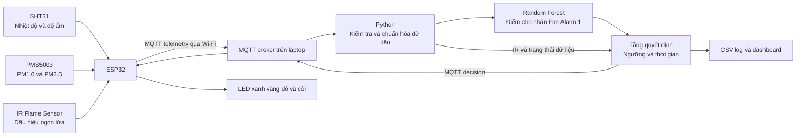

# Thiết kế hệ thống IoT cảnh báo cháy ba mức

Ngày cập nhật: 04/11/2026. Phiên bản thiết kế: 1.1.

Tài liệu hướng dẫn nhóm triển khai mô hình môn IoT bằng ESP32, SHT31, PMS5003 và cảm biến ngọn lửa hồng ngoại. Mục tiêu là hoàn thành một hệ thống thu thập dữ liệu, suy luận và cảnh báo có thể giải thích, đánh giá và trình diễn. Đây là thiết kế đề xuất; các tham số thời gian và ngưỡng dưới đây chưa phải kết quả đã kiểm chứng.

## 1. Phạm vi và quyết định thiết kế

- ESP32 đọc cảm biến, gửi dữ liệu, điều khiển LED/còi và xử lý tình trạng mất kết nối.
- Laptop chạy MQTT broker, chương trình Python, Random Forest, bộ quyết định và giao diện theo dõi. Không cần GPU, Raspberry Pi hoặc cloud.
- Phạm vi phần cứng chốt: SHT31 đo nhiệt độ/độ ẩm, PMS5003 đo PM1.0/PM2.5, cộng cảm biến IR. RF chỉ dùng đúng bốn đặc trưng trên; IR kết hợp ở tầng quyết định. Không yêu cầu bổ sung cảm biến để cung cấp các cột còn lại của dataset.
- Dataset công khai có nhãn `Fire Alarm` nhị phân. Không tự tạo nhãn ba lớp để giả định rằng dataset đã có lớp “cần chú ý”.
- Ba mức hiển thị do tầng quyết định tạo ra: `SAFE`, `ATTENTION`, `FIRE_ALERT`.
- Hồng ngoại được kết hợp ở tầng quyết định, chưa đưa vào Random Forest vì dataset đang chọn không có cột tương ứng.
- Phiên bản đầu dùng Random Forest từng thời điểm và xác nhận theo thời gian. Không mô tả thành mô hình AI học chuỗi thời gian hoặc logic mờ.
- Không đưa chỉ dẫn thoát hiểm vào phần bắt buộc. Có thể ghi ở hướng phát triển.

Tên đề tài phù hợp: **Hệ thống IoT hỗ trợ cảnh báo cháy ba mức dựa trên hợp nhất dữ liệu đa cảm biến và xác nhận theo thời gian**.

## 2. Kiến trúc tổng thể



Hai luồng tách biệt: cảm biến gửi số đo lên laptop; laptop trả quyết định xuống ESP32. Nếu laptop ngừng hoạt động, ESP32 vẫn phải nhận biết mất kết nối và hiển thị lỗi, không tự báo “an toàn”.

## 3. Dữ liệu dùng để huấn luyện

### 3.1. Nguồn dữ liệu

Dùng Smoke Detection Dataset, bản phân phối tại Kaggle, có nguồn gốc từ dự án của Stefan Blattmann. Dự án gốc có thu thập đa cảm biến và tần suất khoảng 1 Hz. Nhóm phải kiểm tra CSV tải về vì bản phân phối, số dòng và thứ tự cột có thể khác nhau. [1, 2]

Chưa có dataset CSV trong thiết kế này và chưa có mô hình đã huấn luyện được bàn giao. Tải dữ liệu, kiểm tra quyền sử dụng/giấy phép, lưu nguồn và phiên bản trước khi thực hiện.

### 3.2. Đầu vào train

| Cột gốc dự kiến | Tên trong chương trình | Đơn vị cần xác minh | Vai trò |
|---|---|---|---|
| `Temperature[C]` | `temperature_c` | °C | Đặc trưng 1 |
| `Humidity[%]` | `humidity_pct` | %RH | Đặc trưng 2 |
| `PM1.0` | `pm1_ug_m3` | Nồng độ khối lượng, xác minh tài liệu nguồn | Đặc trưng 3 |
| `PM2.5` | `pm25_ug_m3` | Nồng độ khối lượng, xác minh tài liệu nguồn | Đặc trưng 4 |
| `Fire Alarm` | `target` | 0 hoặc 1 | Nhãn huấn luyện |

Sau khi xác minh đơn vị PM tương thích µg/m³, ma trận đầu vào có dạng:

```python
FEATURES = ["temperature_c", "humidity_pct", "pm1_ug_m3", "pm25_ug_m3"]
X.shape == (number_of_samples, 4)
y.shape == (number_of_samples,)
# y chứa nhãn gốc 0/1; giữ nguyên ý nghĩa do nguồn dữ liệu cung cấp.
```

Không dùng `UTC`, `CNT`, chỉ số dòng/`Unnamed: 0` hoặc nhãn làm đặc trưng. Có thể dùng timestamp/counter để xác định phiên và sắp thứ tự. Các cột TVOC, eCO2, áp suất, nồng độ số hạt không dùng trong phiên bản này vì phần cứng không cung cấp đủ các đầu vào đó.

### 3.3. Làm sạch và chia dữ liệu

1. Kiểm tra tên cột, kiểu số, nhãn 0/1, giá trị thiếu, vô cực và bản ghi trùng.
2. Kiểm tra đơn vị, miền đo và các đoạn bão hòa; không tự đặt mọi giá trị PM lớn thành lỗi.
3. Xác định phiên thu từ metadata nếu có. Counter reset và khoảng trống timestamp chỉ là dấu hiệu hỗ trợ, không bảo đảm là phiên độc lập.
4. Ưu tiên chia theo phiên/kịch bản thành train, validation và test; mục tiêu tỷ lệ khoảng 60/20/20 khi số phiên và phân bố nhãn cho phép.
5. Nếu không có mã phiên đáng tin: chia theo các khối thời gian liên tục trong từng chuỗi đã xác định, dùng khoảng đệm khởi đầu ít nhất 10 giây ở biên. Khoảng này chưa bảo đảm độc lập; kiểm tra phụ thuộc theo thời gian, thử khoảng đệm lớn hơn trên train/validation và kiểm tra các đoạn trùng giữa tập chia. Ghi rõ đánh giá này chưa chứng minh khả năng tổng quát sang kịch bản mới.
6. Kiểm tra mỗi tập có đủ hai nhãn và các sự kiện cần đánh giá. Nếu không, dùng các fold theo nhóm hoặc các mốc chia khác có giải thích; không âm thầm đổi sang chia ngẫu nhiên để tăng điểm.
7. Chỉ fit xử lý dữ liệu và mô hình trên train. Chọn tham số/ngưỡng trên validation; giữ test độc lập cho đánh giá cuối.

Random Forest không bắt buộc chuẩn hóa Min-Max hoặc StandardScaler. Phiên bản đầu loại bản ghi thiếu đặc trưng bắt buộc; lúc vận hành đánh dấu dữ liệu lỗi, không thay giá trị thiếu bằng 0. Nếu sau này dùng imputation, phải fit trên train và đánh giá tác động riêng.

## 4. Thiết kế Random Forest

### 4.1. Cấu hình khởi đầu

Dùng `RandomForestClassifier` của scikit-learn. Đây là cấu hình thử ban đầu, chưa phải cấu hình tối ưu:

```python
RandomForestClassifier(
    n_estimators=100,
    max_depth=12,
    min_samples_leaf=3,
    class_weight="balanced",
    random_state=42,
    n_jobs=-1,
)
```

Có thể thử nhỏ: `max_depth` trong `{8, 12, None}`, `min_samples_leaf` trong `{1, 3, 5}`. Giữ ngân sách tìm kiếm thấp, lựa chọn dựa trên validation và tiêu chí báo động giả/bỏ sót, không chỉ accuracy.

Lưu cùng mô hình: danh sách và thứ tự đặc trưng, đơn vị, miền hỗ trợ từ train, phiên bản thư viện, cách chia dữ liệu, nguồn dataset và cấu hình quyết định. Chỉ tải file mô hình do nhóm tạo hoặc nguồn tin cậy.

### 4.2. Đầu vào khi suy luận

Một lần dự đoán dùng đúng bốn giá trị tại một thời điểm:

```python
x_t = [[temperature_c, humidity_pct, pm1_ug_m3, pm25_ug_m3]]
positive_index = list(model.classes_).index(1)
p_fire = model.predict_proba(x_t)[0, positive_index]
```

Ví dụ cấu trúc, không phải kết quả thử nghiệm:

```text
Input:  [28.4, 64.2, 12.0, 18.0]
Output: p_fire trong [0, 1], chỉ biết sau khi chạy mô hình đã huấn luyện.
```

`model.predict()` trả nhãn 0/1. `predict_proba()` trả điểm cho các lớp; không mặc định lớp 1 luôn nằm ở cột thứ hai mà phải kiểm tra `classes_`. Điểm RF chưa được hiệu chuẩn không được diễn giải là “xác suất cháy thực tế chính xác X%”.

### 4.3. Phân biệt đầu ra mô hình và hệ thống

| Thành phần | Đầu ra | Ý nghĩa |
|---|---|---|
| Random Forest | `p_fire`, nhãn 0/1 tùy nhu cầu | Dự đoán nhãn dataset |
| Tầng quyết định | `SAFE`, `ATTENTION`, `FIRE_ALERT` | Mức vận hành dựa vào điểm, lịch sử và IR |
| Giám sát thiết bị | `OK`, `WARMUP`, `SENSOR_FAULT`, `LINK_LOST`… | Sức khỏe hệ thống, tách khỏi mức cảnh báo |

Không dùng ba mức để vẽ confusion matrix ba lớp trên dataset chỉ có nhãn hai lớp. Không gọi mức `ATTENTION` là lớp cháy sớm có ground truth nếu chưa có dữ liệu chứng minh.

## 5. Cửa sổ thời gian và logic quyết định

### 5.1. Tham số khởi đầu để triển khai

| Tham số | Giá trị ban đầu | Mục đích |
|---|---:|---|
| Chu kỳ telemetry | 1 giây | Một bộ số đo đồng bộ gần thời điểm gửi |
| Cửa sổ lịch sử | 5 mẫu hợp lệ liên tiếp | Mẫu đầu–cuối cách khoảng 4 giây ở 1 Hz; không phải độ trễ cố định |
| `T_LOW` | 0.30 | Ngưỡng cần chú ý |
| `T_HIGH` | 0.70 | Ngưỡng điểm cao |
| Xác nhận điểm cao | Ít nhất 3/5 mẫu có `p_fire >= T_HIGH` | Hạn chế một đỉnh nhiễu |
| Xác nhận IR | DO active liên tục 2 giây | Lọc chập chờn tín hiệu |
| Hạ từ ATTENTION về SAFE | 10 mẫu liên tiếp có `p_fire < T_LOW` và IR không active | Giảm nhấp nháy trạng thái |
| Timeout kết quả trên ESP32 | 5 giây | Phát hiện laptop hoặc mạng ngừng phản hồi |

Các số trên chỉ giúp nhóm viết phiên bản đầu. Chọn lại ngưỡng và thời gian trên validation, báo cáo ảnh hưởng lên số báo động giả, bỏ sót và độ trễ. Không dùng test để chọn bộ tham số tốt nhất.

### 5.2. Xử lý tín hiệu IR

ESP32 đọc DO khoảng mỗi 50 ms bằng lịch không chặn. Xác định `active_level` từ tài liệu và thử module thực tế; nhiều module active-low nhưng không được mặc định mọi module như nhau. Duy trì `ir_active_duration_ms`; giá trị về 0 khi tín hiệu không active. Laptop nhận `ir_confirmed = duration >= 2000`.

Đặt cảm biến hướng vùng cần quan sát. IR không active không chứng minh không có cháy vì nguồn có thể khuất hoặc nằm ngoài góc nhìn. Chưa dùng AO; nếu bổ sung AO trên ESP32 WROOM-32 có Wi-Fi, chọn ADC1 như GPIO32/33 và kiểm tra giới hạn điện áp. GPIO27 trong sơ đồ hiện tại dùng digital DO, không phải ADC. [5]

### 5.3. Luật sinh mức đề xuất

Duy trì cửa sổ W gồm tối đa 5 điểm từ các telemetry mới, đúng thứ tự, cách nhau không quá 1.5 giây. Khi mất mẫu hoặc có dữ liệu lỗi: xóa cửa sổ và bộ đếm hạ mức. Chỉ xét luật 3/5 khi đã có đủ 5 mẫu.

```text
high_confirmed = W đủ 5 mẫu và count(p >= T_HIGH trong W) >= 3
ir_confirmed   = IR active liên tục ít nhất 2 giây
combined       = ir_confirmed và p_fire hiện tại >= T_LOW

Chỉ áp dụng luật điểm khi bốn đầu vào RF hợp lệ, mới và trong miền hỗ trợ; trường hợp khác theo mục 7.1.

Nếu FIRE_ALERT đã chốt: giữ FIRE_ALERT.
Ngược lại, nếu high_confirmed hoặc combined: FIRE_ALERT và chốt cảnh báo.
Ngược lại, nếu p_fire >= T_LOW hoặc ir_confirmed: ATTENTION.
Ngược lại:
    Nếu trước đó ATTENTION: chỉ về SAFE sau 10 mẫu thấp liên tiếp, tín hiệu IR thô không active trong cả khoảng này.
    Nếu đã đủ cửa sổ khởi tạo và không có lỗi: SAFE.
    Nếu chưa đủ dữ liệu: chưa công bố SAFE; health = WARMUP.
```

IR đơn độc chỉ đưa lên ATTENTION trong thiết kế này. Luật kết hợp IR + điểm RF có thể cải thiện hoặc làm xấu kết quả; cần đánh giá riêng, chưa được coi là cải tiến đã chứng minh. Không hạ FIRE_ALERT vì IR không nhìn thấy lửa.

### 5.4. Giữ cảnh báo, tắt tiếng và reset

- FIRE_ALERT được chốt để tránh còi/LED bật tắt theo nhiễu. Ghi thời điểm và nguyên nhân kích hoạt đầu tiên.
- Nút nhấn tắt tiếng chỉ đổi `muted=true`, không xóa mức cảnh báo hoặc LED đỏ.
- Reset cảnh báo là thao tác riêng trên dashboard. Chỉ chấp nhận khi dữ liệu và kết nối tốt, IR không active và có 10 mẫu điểm thấp liên tiếp.
- Có telemetry lỗi/mất mạng: giữ FIRE_ALERT đã chốt. Nếu chưa có cảnh báo, đặt trạng thái hiển thị “không xác định” cùng health lỗi; không suy diễn thành SAFE hoặc tự kết luận có cháy.
- ESP32 phải tự kiểm tra timeout bằng đồng hồ monotonic, vì khi mất mạng laptop không thể gửi thông báo lỗi xuống.

### 5.5. Đồng bộ latch, mute và reset

Backend quản lý trạng thái chính; ESP32 giữ bản sao chốt để duy trì khi mất mạng. Mỗi cảnh báo có `alarm_id` duy nhất. Backend lưu bền alarm_id, nguyên nhân, thời điểm và trạng thái reset. ESP32 lưu chốt/alarm_id vào bộ nhớ không mất điện khi trạng thái đổi, không ghi flash mỗi giây.

- Decision thông thường có `alarm_latched=false` không xóa được chốt cục bộ. Mute chỉ tắt tiếng. Reset thành công xóa mute để lần cảnh báo sau phát còi bình thường.
- Dashboard yêu cầu backend reset; backend kiểm tra dữ liệu/kết nối tốt, bốn đầu vào trong miền, IR thô không active và đủ 10 mẫu thấp liên tiếp.
- Lệnh reset riêng chứa `command_id`, `alarm_id`, `boot_id`, `expected_source_seq`. ESP32 chỉ chấp nhận nếu khớp chốt/boot hiện hành, decision còn mới, source_seq không cũ quá ngân sách đã cấu hình và IR cục bộ không active. Điều kiện không còn đúng thì từ chối.
- ESP32 ACK với các ID tương ứng, kết quả `APPLIED` hoặc `REJECTED` và lý do. Lệnh trùng trả lại kết quả cũ, không thực hiện lại. Backend chỉ hoàn tất reset sau ACK APPLIED; nếu mất ACK thử lại cùng command_id và hiển thị đang chờ.
- Khi backend restart hoặc boot_id thay đổi, đồng bộ latch trước khi công bố SAFE. Nếu bất kỳ bên nào còn chốt thì giữ cảnh báo và ghi lỗi đồng bộ; nếu cả hai không chốt vẫn WARMUP đến khi đủ mẫu mới. ESP32 khôi phục chốt khi khởi động thay vì làm mất cảnh báo do reset nguồn.
- Đồng bộ mute kèm phiên bản trạng thái. Nếu không xác định được mute sau restart thì mặc định không mute chốt đang giữ.

### 5.6. Quy tắc thời gian thực thi

- Dùng `uptime_ms` tại thời điểm tạo telemetry để kiểm tra khoảng cách mẫu không quá 1.5 giây, kết hợp tuổi từng phép đo. Firmware dùng uptime 64-bit hoặc xử lý tràn bộ đếm rõ ràng.
- Dùng `(device_id, boot_id, seq)` để kiểm tra thứ tự; gói trùng/cũ không cập nhật W, bộ đếm hoặc timeout.
- Mất mẫu, dữ liệu lỗi/ngoài miền, đổi boot_id hoặc mất kết nối: xóa W và bộ đếm xác nhận/hạ mức; giữ latch. Mẫu ngoài miền không được vào W.
- Không coi các bản tin tồn đọng đến dồn là mẫu mới liên tiếp. ESP32 không phát lại hàng đợi telemetry cũ; sau reconnect backend bỏ dữ liệu của phiên kết nối cũ và tạo lại cửa sổ.
- Khi kết nối vẫn tồn tại nhưng dữ liệu bị trễ, cần kiểm tra freshness: backend gửi challenge có ID/nonce; ESP32 phản hồi bằng telemetry mới gắn nonce đó. Backend đo thời gian challenge–response bằng monotonic, chỉ dùng phản hồi một lần trong ngân sách cấu hình (khởi đầu 1.5 giây), đồng thời kiểm tra tuổi cảm biến. Không xác minh được thì WARMUP/lỗi kết nối, không công bố SAFE. seq tăng và age nhỏ tự chúng chưa chứng minh gói vừa đến là mới.
- Năm mẫu ở 1 Hz có khoảng mẫu đầu–cuối khoảng 4 giây. Thời gian phát hiện còn phụ thuộc vị trí sự kiện, ngưỡng, cửa sổ khởi tạo và truyền thông; đo bằng replay/thử nghiệm, không báo độ trễ cố định 5 giây.

### 5.7. Giới hạn của cửa sổ thời gian

RF hiện không học các đặc trưng như tốc độ tăng nhiệt hoặc trung bình 5 giây. Tính thời gian nằm ở tầng xác nhận. Nếu muốn RF học cửa sổ, cần xây dựng lại dữ liệu train thành đặc trưng lịch sử, ví dụ mean/max/slope, và áp dụng giống hệt khi chạy; các cửa sổ không được vượt ranh giới phiên hoặc tập chia. Đây là bước mở rộng sau khi bản cơ bản hoàn thành.

## 6. Phần cứng và sơ đồ chân

### 6.1. Danh sách tối thiểu

| Linh kiện | Số lượng | Yêu cầu |
|---|---:|---|
| ESP32 DevKit dùng WROOM-32 | 1 | Có USB, chân cắm đã hàn; 30/38 chân đều có thể dùng |
| Module SHT31 I²C | 1 | Hỗ trợ nguồn và logic 3.3 V; chân cắm đã hàn |
| PMS5003 + dây + adapter | 1 bộ | Cấp 5 V; giao tiếp UART logic 3.3 V |
| IR Flame Sensor có DO | 1 | Hỗ trợ 3.3 V; xác minh mức active |
| LED xanh, vàng, đỏ | Mỗi màu 1 | LED hai chân |
| Điện trở 330 Ω | 3 | Mỗi LED một điện trở |
| Module còi chủ động có mạch kích | 1 | Nguồn và ngõ điều khiển tương thích 3.3 V |
| Nút nhấn | 1 | Tắt tiếng; tùy chọn nhưng hữu ích |
| Breadboard và dây jumper | 1 bộ | Dây đực–đực, đực–cái |
| Cáp USB truyền dữ liệu | 1 | Đúng cổng ESP32 |
| Nguồn USB 5 V–2 A | 1 | Dùng khi demo độc lập; có thể thử nguồn laptop khi phát triển |
| Laptop có Wi-Fi | 1 | Chạy Python, broker và dashboard |

OLED và hộp có khe thông khí là tùy chọn. Không cần MQ-2/MQ-135 cho thiết kế này. Nếu đã mua module còi 5 V, phải kiểm tra mạch điều khiển tương thích 3.3 V trước khi thay vào cấu hình.

### 6.2. Bảng nối dây cho WROOM-32

| Thiết bị | Chân thiết bị | Nối tới |
|---|---|---|
| SHT31 | VCC/VIN; GND | 3V3; GND |
| SHT31 | SDA; SCL | GPIO21; GPIO22 |
| PMS5003 | VCC; GND | Đường 5 V đã xác minh; GND |
| PMS5003 | TXD | GPIO16, RX của UART cấu hình trong code |
| PMS5003 | RXD | Để trống nếu chỉ nhận luồng mặc định |
| PMS5003 | SET/RST | Theo tài liệu adapter; bảo đảm không kéo xuống, không nối 5 V vào chân logic |
| Flame Sensor | VCC; GND | 3V3; GND |
| Flame Sensor | DO | GPIO27 |
| Flame Sensor | AO | Để trống |
| LED xanh | Anode qua 330 Ω; cathode | GPIO18; GND |
| LED vàng | Anode qua 330 Ω; cathode | GPIO19; GND |
| LED đỏ | Anode qua 330 Ω; cathode | GPIO23; GND |
| Module còi | VCC; GND; IN | 3V3; GND; GPIO25 |
| Nút tắt tiếng | Hai tiếp điểm khác nhau | GPIO26 và GND; dùng INPUT_PULLUP |

Số chân là GPIO, không phải thứ tự đếm trên hàng cắm. Các chân này chưa áp dụng nguyên xi cho S3/C3 hoặc board dùng PSRAM chiếm chân tương ứng.

### 6.3. Cấp nguồn

```text
USB laptop khi lập trình HOẶC củ USB 5 V khi chạy độc lập
                       |
                    Cổng USB ESP32
                       |
                       +-- 3V3 --> SHT31, IR, module còi tương thích
                       +-- 5V* --> PMS5003
                       +-- GND --> GND chung mọi module

* Chỉ dùng chân 5V/VIN khi tài liệu/đo kiểm xác nhận có 5 V từ USB.
```

PMS5003 cần 5 V để chạy quạt, nhưng UART dùng logic 3.3 V. Không đưa 5 V vào GPIO/3V3. Không cấp PMS5003 từ đường 3V3. Không đồng thời cấp nguồn ngoài vào 5V/VIN và cấp USB nếu chưa xác minh thiết kế bảo vệ nguồn của board. Kiểm tra nguồn nếu ESP32 reset khi bật Wi-Fi. [3, 4]

Giữ cửa hút/xả PMS5003 thông thoáng; đặt SHT31 tránh sát bộ ổn áp, ESP32 hoặc luồng khí nóng cục bộ. Cảm biến IR cần có đường quan sát ra ngoài hộp.

## 7. Khớp dữ liệu thật với dữ liệu train

- SHT31 trả °C và %RH, không dùng giá trị ADC thô thay thế.
- PMS5003 có các trường nồng độ theo chuẩn CF=1 và môi trường; phiên bản đầu đọc trường atmospheric/environmental, nhưng phải kiểm tra tính tương thích với định nghĩa PM của dataset trước khi chốt. Ghi rõ trường được dùng, không trộn hai loại giữa train và runtime.
- Kiểm tra checksum và chiều dài frame PMS5003, không chỉ đọc số byte tại vị trí cố định mà không xác nhận frame.
- Nguồn gốc dataset dùng SPS30, còn phần cứng nhóm dùng PMS5003: cùng tên PM không bảo đảm cùng đáp ứng hoặc hiệu chuẩn. Đây là domain shift cần ghi trong báo cáo. [2, 3]
- Không tự nhân hệ số để ép PMS5003 giống phân bố train. Muốn hiệu chỉnh phải có dữ liệu tham chiếu phù hợp và đánh giá độc lập.
- Một đặc trưng ngoài khoảng min/max của train: vẫn có thể tính điểm để chẩn đoán nhưng gắn `OUT_OF_DISTRIBUTION`; thiết kế không dùng bản ghi đó để xác nhận SAFE hay reset cảnh báo. Miền min/max chỉ là phép kiểm tra thô, không phải bộ phát hiện OOD hoàn chỉnh.

### 7.1. Quyền đổi mức khi dữ liệu lỗi hoặc ngoài miền

Kiểm tra miền vật lý theo tài liệu cảm biến, không lấy min/max train làm giới hạn vật lý. Không dùng điểm RF cũ thay cho điểm hiện tại bị thiếu.

| Tình trạng | RF và cửa sổ | Mức khi chưa chốt | Hạ mức/SAFE/reset |
|---|---|---|---|
| Đủ bốn đầu vào, mới, hợp lệ, trong miền hỗ trợ và IR hợp lệ | Suy luận, cập nhật W | Theo mục 5.3 | Theo điều kiện policy |
| Thiếu đầu vào RF, NaN/vô cực, lỗi frame hoặc ngoài miền vật lý | p_fire=null; xóa W/bộ đếm | IR độc lập mới, hợp lệ, đã xác nhận → ATTENTION; còn lại risk_level=null | Không được |
| Phép đo hợp lệ nhưng ngoài miền train | Chỉ tính p_fire_diagnostic; p_fire=null; xóa W/bộ đếm | IR hợp lệ đã xác nhận → ATTENTION; còn lại risk_level=null; điểm chẩn đoán không kích hoạt FIRE_ALERT | Không được |
| IR lỗi nhưng đủ bốn đầu vào RF hợp lệ | RF vẫn chạy | RF đủ 3/5 vẫn chốt FIRE_ALERT; không dùng combined | Không SAFE/reset đến khi IR hoạt động lại; ATTENTION giữ nguyên nếu đã có |
| Telemetry cũ/mất kết nối | Không dùng lại điểm RF/IR cũ; xóa W/bộ đếm | risk_level=null | Không được |

Trong mọi trường hợp giữ FIRE_ALERT đã chốt. Health hiển thị đồng thời với mức cảnh báo, ví dụ ATTENTION + SENSOR_FAULT. IR chỉ dùng độc lập khi dữ liệu mới và đường đọc hợp lệ; DO đơn giản không bảo đảm phát hiện được đứt dây/kẹt mức, cần kiểm tra chức năng trước demo và nêu giới hạn.

Min/max chỉ là hàng rào thô: tổ hợp bốn giá trị trong từng khoảng vẫn có thể chưa từng xuất hiện khi train. Đóng băng cấu hình kiểm tra miền từ train/validation trước test. Báo tỷ lệ không xác định/ngoài miền, không loại các mẫu đó khỏi đánh giá toàn hệ thống.

## 8. Giao thức truyền và dữ liệu

### 8.1. Topic đề xuất

```text
fire/node01/telemetry   ESP32 -> laptop, QoS 1, không retain
fire/node01/decision    laptop -> ESP32, QoS 1, không retain
fire/node01/status      trạng thái kết nối và đồng bộ latch; có thể dùng Last Will
fire/node01/command     backend -> ESP32, reset có ID, QoS 1, không retain
fire/node01/ack         ESP32 -> backend, ACK xử lý lệnh, QoS 1, không retain
fire/node01/challenge   backend -> ESP32, nonce kiểm tra freshness, không retain
```

QoS 1 có thể gửi trùng. Dùng `(device_id, boot_id, seq)` để loại trùng; đổi boot_id mỗi lần khởi động. Không giữ lại quyết định cũ bằng MQTT retain. Đồng hồ hệ thống dùng ghi log; timeout dùng thời gian monotonic tại máy nhận.

### 8.2. Ví dụ telemetry

```json
{
  "schema_version": 1,
  "device_id": "node01",
  "boot_id": "example-boot-001",
  "seq": 100,
  "uptime_ms": 120000,
  "temperature_c": 28.4,
  "humidity_pct": 64.2,
  "pm1_ug_m3": 12.0,
  "pm25_ug_m3": 18.0,
  "ir_active": false,
  "ir_active_duration_ms": 0,
  "sht_age_ms": 100,
  "pms_age_ms": 150,
  "sensor_status": "OK"
}
```

Không có trường `Fire Alarm` trong input chạy thật: đó là nhãn chỉ có ở train/evaluation. Timestamp UTC có thể bổ sung sau khi đồng bộ giờ; không dùng làm đặc trưng RF.

### 8.3. Ví dụ decision

```json
{
  "schema_version": 1,
  "device_id": "node01",
  "boot_id": "example-boot-001",
  "source_seq": 100,
  "model_version": "rf_v1",
  "policy_version": "policy_v1",
  "p_fire": 0.18,
  "risk_level": "SAFE",
  "health": "OK",
  "reason_codes": ["LOW_SCORE_CONFIRMED"],
  "alarm_latched": false,
  "alarm_id": null,
  "muted": false,
  "valid_for_ms": 5000
}
```

Điểm 0.18 ở đây chỉ minh họa định dạng, không phải dự đoán thật cho telemetry ví dụ. Khi không có dữ liệu hợp lệ, `p_fire` và `risk_level` có thể là `null`; FIRE_ALERT đã chốt vẫn được giữ. ESP32 từ chối quyết định sai boot_id, trùng/cũ hoặc source_seq đã tụt quá xa so với mẫu đang gửi; timeout phải tính từ lần nhận quyết định mới hợp lệ, không từ gói lặp lại.

## 9. Phân chia phần mềm và vòng xử lý

### 9.1. ESP32

1. Khởi tạo I²C, UART, GPIO, Wi-Fi và MQTT; LED xanh chưa bật.
2. Khởi tạo cảm biến, áp dụng thời gian ổn định theo tài liệu thiết bị; PMS5003 cần khoảng ổn định sau khởi động/đánh thức, không dùng vài frame đầu để kết luận.
3. Đọc UART liên tục vào bộ giải mã frame; đọc IR nhanh; đọc SHT31 và gửi telemetry theo lịch khoảng 1 Hz. Không dùng `delay()` dài chặn các nhiệm vụ này.
4. Theo dõi tuổi dữ liệu; quy ước ban đầu số đo cũ hơn 2 giây là stale. Đồng bộ gần thời điểm gửi, không ghép giá trị cũ mà vẫn báo OK.
5. Nhận decision, kiểm tra tính mới, cập nhật LED/còi và bộ chốt cảnh báo cục bộ.
6. Khi quá 5 giây không có decision hợp lệ: LINK_LOST, tắt LED xanh; nếu đã chốt cháy giữ LED đỏ và cảnh báo theo trạng thái mute.
7. Nút tắt tiếng có debounce, ví dụ 50 ms. Mất điện/khởi động lại phải hiển thị WARMUP, không giả định trạng thái trước đó là SAFE.

| Trạng thái | LED/còi đề xuất |
|---|---|
| SAFE và health OK | Xanh sáng |
| ATTENTION | Vàng sáng, còi tắt |
| FIRE_ALERT | Đỏ sáng, còi phát theo nhịp; mute chỉ tắt còi |
| WARMUP, lỗi cảm biến hoặc mất kết nối, chưa chốt cháy | Vàng nhấp nháy; xanh tắt |
| Lỗi trong khi đã chốt cháy | Giữ đỏ; báo lỗi trên dashboard/log khi kết nối có lại |

### 9.2. Laptop

1. Nạp model và metadata; kiểm tra đúng schema và thứ tự đặc trưng.
2. Subscribe telemetry, loại trùng/gói cũ; ghi thời gian nhận.
3. Kiểm tra trạng thái, miền vật lý, checksum đã báo từ ESP32 và tuổi số đo.
4. Dữ liệu hợp lệ: suy luận RF, cập nhật cửa sổ riêng cho từng node, chạy tầng quyết định.
5. Dữ liệu lỗi: không suy luận như bình thường; xóa cửa sổ đang tích lũy, giữ latch và cập nhật health.
6. Publish decision, ghi log; dashboard hiển thị số đo, điểm RF, mức cảnh báo, lý do và thời điểm cập nhật cuối.
7. Theo dõi node mất kết nối ngay cả khi không có telemetry mới. Dashboard không giữ số đo cũ như đang live.

### 9.3. Cấu trúc mã nguồn đề xuất

```text
firmware/                 Chương trình ESP32
training/                 Làm sạch, chia dữ liệu, train, đánh giá
backend/                  MQTT consumer, inference, policy, logging
models/                   model.joblib, metadata.json, policy.json
data/raw/                 CSV gốc, giữ nguyên
data/processed/           Manifest train/validation/test
logs/                     Dữ liệu chạy thật và replay
reports/                  Biểu đồ, bảng kết quả
```

Đóng băng phiên bản thư viện khi chạy thành công, ghi trong `requirements.txt`. Không cần Docker ở bản đầu nếu nhóm chưa quen.

## 10. Đánh giá và cách viết kết quả

### 10.1. Ba cấu hình so sánh chính trên dataset công khai

| Cấu hình | Cách thực hiện | Mục đích |
|---|---|---|
| A | Ngưỡng PM2.5 đơn, chọn bằng validation | Baseline cảm biến đơn |
| B | RF bốn đầu vào, cảnh báo ngay khi vượt T_HIGH | Đo tác động hợp nhất cảm biến |
| C | Cùng RF và ngưỡng của B, thêm xác nhận 3/5 | Đo đánh đổi báo động giả và độ trễ |

Có thể thêm Decision Tree nếu đủ thời gian. IR không có trong dataset nên không được gán giả vào test để công bố kết quả cấu hình D. Đánh giá IR bằng dữ liệu đồng bộ thu riêng hoặc bài kiểm tra logic, ghi đúng phạm vi.

Trước tích hợp phần cứng, đánh giá A/B/C trên cùng manifest chia dữ liệu. Chốt mục tiêu recall, báo động giả, độ trễ và tỷ lệ không xác định trước test. Nếu RF bốn biến chưa đạt, phân tích lỗi và điều chỉnh trên train/validation; không chỉ tăng số cây hoặc chọn ngưỡng lại trên test.

Phạm vi bắt buộc chỉ gồm bốn đầu vào RF cộng IR, không yêu cầu mua thêm cảm biến. RF 12 biến nếu làm chỉ là phân tích offline tùy chọn về thông tin bị mất, không phải mô hình triển khai hoặc tiêu chí hoàn thành. Nếu bốn biến tổng quát kém, ưu tiên thu dữ liệu đồng bộ từ đúng SHT31/PMS5003/IR hiện có, ghi rõ nguồn nhãn và giữ tập đánh giá độc lập.

### 10.2. Chỉ số

- Với nhãn nhị phân: precision, recall, F1 lớp 1, confusion matrix, FPR = FP/(FP+TN); accuracy là chỉ số phụ.
- Báo tỷ lệ bản ghi/thời gian lỗi, ngoài miền và không xác định. Khi đánh giá báo động nhị phân toàn hệ thống, thời điểm không phát FIRE_ALERT vẫn là chưa báo động, kể cả không xác định; không loại chúng để tăng recall.
- Với tầng cảnh báo: coi FIRE_ALERT là phát báo động, còn SAFE/ATTENTION là chưa phát báo động để đối chiếu nhãn 0/1; báo thêm tỷ lệ thời gian ATTENTION.
- Đánh giá khả năng phát hiện của policy trước khi thêm thao tác giữ còi/reset của giao diện, hoặc quy định quy trình reset theo từng phiên cho mọi cấu hình. Không để latch kéo dài làm sai so sánh FPR.
- Một sự kiện dương là đoạn nhãn 1 liên tục trong một phiên, không bắc qua khoảng thiếu dữ liệu. Delay = thời điểm báo động đầu tiên từ đầu sự kiện trừ thời điểm bắt đầu nhãn 1. Sự kiện không báo phải tính bỏ sót, không loại khỏi bảng.
- Báo độ trễ suy luận laptop và độ trễ đầu cuối riêng. Nếu hai thiết bị chưa đồng bộ đồng hồ, dùng đo round-trip trên ESP32, không suy ra one-way delay từ hai timestamp lệch nhau.
- Chỉ số theo thời gian tính khi biết tần suất và chuỗi liên tục. Không ghép các dòng test đã shuffle để đo delay.

### 10.3. Thử nghiệm phần cứng

- Kiểm tra số đo nhiệt độ/độ ẩm, PMS5003, IR và LED/còi độc lập.
- Thử chạy nền, mất Wi-Fi, tắt backend, thiếu frame, gửi trùng và khởi động lại để xác nhận hệ thống không báo SAFE khi dữ liệu lỗi.
- Replay các chuỗi test qua cùng backend để trình diễn đường suy luận. Gắn nhãn `REPLAY`, không trình bày như thử cháy trực tiếp.
- Mô phỏng mức DO hoặc phát lại tín hiệu IR chỉ kiểm tra logic, chưa chứng minh độ chính xác phát hiện ngọn lửa của phần cứng.
- Không tạo đám cháy để lấy dữ liệu trong phòng học. Nếu có thử nguồn lửa thật, chỉ thực hiện trong điều kiện được cơ sở cho phép và giám sát phù hợp.

## 11. Các bước thực hiện và tiêu chí hoàn thành

| Bước | Công việc | Kết quả cần có |
|---|---|---|
| 1 | Chốt mã board, module, chân và nguồn | Bảng đấu dây đúng phần cứng đã mua |
| 2 | Đọc từng cảm biến | Log có đơn vị, frame hợp lệ, nhận biết lỗi |
| 3 | Tải và kiểm tra dataset | Nguồn/giấy phép, thống kê nhãn, manifest chia dữ liệu |
| 4 | Train RF và baseline | Model lưu được, dự đoán lặp lại được, không dùng nhãn làm input |
| 5 | Chọn policy trên validation | File ngưỡng/thời gian, bảng đánh đổi |
| 6 | Kết nối MQTT và dashboard | Một telemetry tạo một decision có source_seq tương ứng |
| 7 | Thêm IR, latch, mute và health | Hoạt động theo bảng luật, mất mạng không giữ xanh |
| 8 | Chạy test độc lập và replay | Bảng kết quả thật, log và các giới hạn |
| 9 | Viết báo và chuẩn bị demo | Sơ đồ, phương pháp, kết quả, thảo luận; không bịa số liệu |

Mức hoàn thành môn học: có một node hoạt động, dữ liệu được lưu, RF chạy trên laptop, ba mức hiển thị đúng luật, lỗi được nhận biết, baseline và đánh giá độc lập có thể tái lập. Chưa cần đưa RF lên ESP32.

## 12. Các giới hạn phải nêu trong báo cáo

1. Nhãn train nhị phân; mức cần chú ý là mức vận hành thiết kế, không phải lớp có nhãn độc lập.
2. RF + luật thời gian là cách kết hợp thành phần có sẵn; chưa có cơ sở nhận là thuật toán mới.
3. Dataset và cảm biến bụi thực tế khác nhau; số liệu offline không bảo đảm độ chính xác hiện trường.
4. Nhãn Fire Alarm của nguồn là mục tiêu được học; không mặc định tương đương mức nguy hiểm cháy đã được chuyên gia đánh giá.
5. IR chỉ hỗ trợ vùng quan sát; chưa có dữ liệu đủ để khẳng định giảm báo động giả.
6. Hệ thống phụ thuộc laptop và Wi-Fi; mất kết nối chỉ có logic báo lỗi và giữ cảnh báo đã chốt, chưa có suy luận RF cục bộ dự phòng.
7. Đây là mô hình học tập, chưa được chứng nhận để thay thế thiết bị báo cháy bảo vệ thực tế.

## 13. Nguồn tham khảo kỹ thuật

[1] Smoke Detection Dataset, bản phân phối Kaggle: https://www.kaggle.com/datasets/deepcontractor/smoke-detection-dataset

[2] Stefan Blattmann, dự án nguồn Real-time Smoke Detection with AI-based Sensor Fusion: https://www.hackster.io/stefanblattmann/real-time-smoke-detection-with-ai-based-sensor-fusion-1086e6

[3] Plantower PMS5003 manual: https://cdn-shop.adafruit.com/product-files/3686/plantower-pms5003-manual_v2-3.pdf

[4] Espressif, hướng dẫn nguồn ESP32 DevKitC; đối chiếu thêm sơ đồ board thực tế: https://docs.espressif.com/projects/esp-idf/en/v5.0.5/esp32/hw-reference/esp32/get-started-devkitc.html

[5] Espressif, giới hạn ADC2 khi sử dụng Wi-Fi trên ESP32: https://docs.espressif.com/projects/esp-idf/en/v4.2/esp32/api-reference/peripherals/adc.html

Các URL trên là tài liệu tham khảo. Thông số module clone phải kiểm tra riêng theo sản phẩm nhóm mua.
